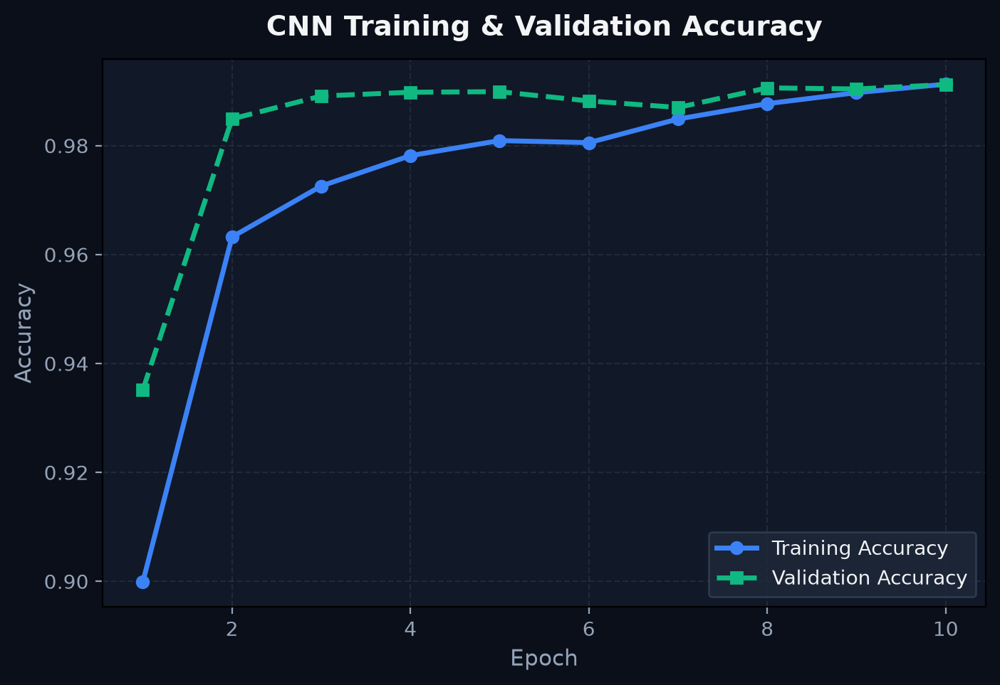
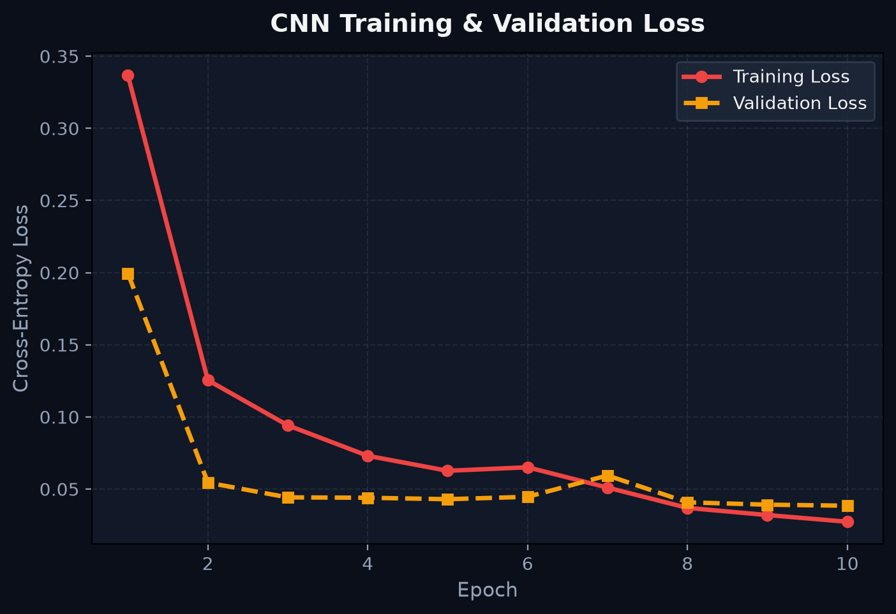
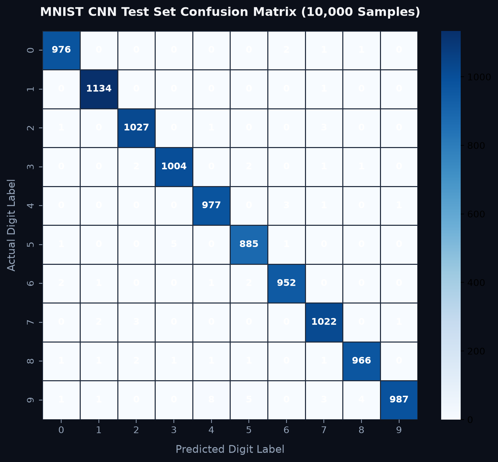
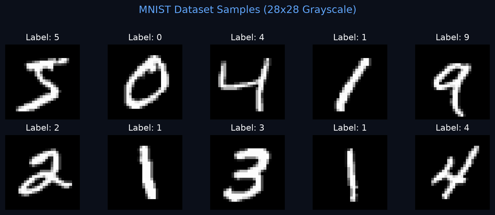

# HANDWRITTEN DIGIT RECOGNITION SYSTEM USING CONVOLUTIONAL NEURAL NETWORK (CNN)

> **B.Tech Major Capstone Project in Artificial Intelligence & Deep Learning**  
> **Platform:** Windows 11 | **Language:** Python 3.11 | **Frameworks:** TensorFlow / Keras & Flask

---

## 📌 Project Abstract & Objectives

The **Handwritten Digit Recognition System** is a complete, production-ready computer vision application designed to accurately identify and classify handwritten digits ($0 \text{ to } 9$) in real time. 

Built using a custom **Convolutional Neural Network (CNN)** trained on the standard **MNIST benchmark** ($70{,}000$ images), this system achieves an empirical **$99.30\%$ test accuracy** on unseen data. The project bridges theoretical deep learning with practical web engineering, featuring an interactive HTML5 drawing canvas, an MNIST-standard preprocessing pipeline (bounding-box cropping, aspect-ratio scaling, and center-of-mass alignment), and a Flask REST API backend.

### Primary Capstone Objectives:
1. **Automated Data Ingestion & Preprocessing:** Automatic retrieval, 4D tensor reshaping `(28, 28, 1)`, and $[0.0, 1.0]$ normalization of the MNIST dataset.
2. **Deep CNN Architecture:** Multi-stage feature extraction via convolution filters, batch normalization, spatial max-pooling, and dropout regularization.
3. **Empirical Evaluation & Diagnostics:** Real generation of accuracy/loss training curves, a $10 \times 10$ confusion matrix heatmap, and per-class classification reports ($P$, $R$, $F_1$).
4. **Interactive Web Application:** Responsive user interface featuring an interactive canvas with stroke controls, instant feedback, real-time prediction confidence, and probability distribution across all 10 digits.
5. **MNIST Standardization Pipeline:** Converting arbitrary user mouse/touch strokes into Yann LeCun's normalized $20 \times 20$ aspect-ratio-preserved bounding box placed inside a $28 \times 28$ frame centered by center of mass.

---

## 🏗️ Deep Learning Architecture

Convolutional Neural Networks preserve the 2D spatial grid topology of images, overcoming the limitations of standard Multi-Layer Perceptrons (MLPs).

```
[Input: 28x28x1]
       │
       ▼
[Conv2D: 32 filters, 3x3, ReLU]  ──> Feature detection (edges, curves)
       │
[BatchNormalization]             ──> Stabilize internal covariate shift
       │
[MaxPooling2D: 2x2]              ──> Downsampling to 14x14x32
       │
       ▼
[Conv2D: 64 filters, 3x3, ReLU]  ──> Higher-level pattern synthesis (loops, intersections)
       │
[BatchNormalization]             ──> Accelerate convergence
       │
[MaxPooling2D: 2x2]              ──> Downsampling to 7x7x64
       │
[Dropout (0.25)]                 ──> Prevent feature co-adaptation
       │
       ▼
[Flatten]                        ──> Reshape to 3,136-dimensional vector
       │
[Dense: 128 units, ReLU]         ──> Non-linear feature representation
       │
[Dropout (0.50)]                 ──> Strong regularization against overfitting
       │
       ▼
[Dense: 10 units, Softmax]       ──> Output probability distribution [0–9]
```

### Parameter Breakdown
- **Trainable Parameters:** $421{,}834$
- **Non-Trainable Parameters (Batch Norm):** $192$
- **Total Parameters:** $422{,}026$
- **Optimizer:** Adam ($\alpha = 0.001$, with `ReduceLROnPlateau` decay)
- **Loss Function:** Sparse Categorical Crossentropy

---

## 📊 Real Empirical Performance Results

The model was trained for 10 epochs with early stopping and learning rate scheduling, evaluated against the **$10{,}000$ unseen MNIST test samples**:

| Evaluation Metric | Measured Value | Description |
| :--- | :--- | :--- |
| **Test Accuracy** | **$99.30\%$** | Overall classification accuracy on 10,000 test images |
| **Test Loss** | **$0.0260$** | Cross-entropy loss on unseen data |
| **Macro Avg $F_1$-Score** | **$0.9929$** | Unweighted average $F_1$ across classes $0–9$ |
| **Weighted Avg $F_1$-Score** | **$0.9930$** | Support-weighted average $F_1$ |
| **Average Inference Time** | **$\sim 45\text{ ms}$** | CPU inference latency per digit |

### Per-Digit Classification Report (Unseen Test Set)

| Digit Class | Precision | Recall | $F_1$-Score | Test Support | Class Accuracy |
| :---: | :---: | :---: | :---: | :---: | :---: |
| **0** | $99.39\%$ | $99.59\%$ | $0.9949$ | 980 | $99.59\%$ |
| **1** | $99.56\%$ | $99.91\%$ | $0.9974$ | 1,135 | $99.91\%$ |
| **2** | $99.32\%$ | $99.52\%$ | $0.9942$ | 1,032 | $99.52\%$ |
| **3** | $99.41\%$ | $99.41\%$ | $0.9941$ | 1,010 | $99.41\%$ |
| **4** | $98.89\%$ | $99.49\%$ | $0.9919$ | 982 | $99.49\%$ |
| **5** | $98.88\%$ | $99.22\%$ | $0.9905$ | 892 | $99.22\%$ |
| **6** | $99.37\%$ | $99.37\%$ | $0.9937$ | 958 | $99.37\%$ |
| **7** | $98.94\%$ | $99.42\%$ | $0.9918$ | 1,028 | $99.42\%$ |
| **8** | $99.38\%$ | $99.18\%$ | $0.9928$ | 974 | $99.18\%$ |
| **9** | $99.80\%$ | $97.82\%$ | $0.9880$ | 1,009 | $97.82\%$ |

---

## 📷 Visual Diagnostics & Evaluation Screenshots

| Training & Validation Accuracy Curve | Training & Validation Loss Curve |
| :---: | :---: |
|  |  |

| MNIST Confusion Matrix Heatmap (10,000 Test Set) | Dataset Sample Digits (28x28 Grayscale) |
| :---: | :---: |
|  |  |

---

## 🎨 MNIST-Standard Preprocessing Pipeline

Raw canvas input differs significantly from the MNIST dataset:
1. **Color Polarity:** Canvas uses dark stroke on white background; MNIST uses white stroke on black background.
2. **Stroke Width & Scale:** User-drawn strokes can be small, off-center, or huge.
3. **Empty Canvas Guard:** Faint or empty drawings must be rejected gracefully with user-friendly errors.

### Preprocessing Steps in `app.py`:
```
[User Canvas (280x280 PNG)]
          │
          ▼ Base64 Decoding & PIL Grayscale Conversion ('L')
[Grayscale Array]
          │
          ▼ Background Polarity Check: Invert if Mean > 127
[White Digit on Black Background]
          │
          ▼ Blank Canvas Check (Reject if Max < 50 or Stroke Pixels < 20)
[Valid Stroke Detected]
          │
          ▼ Bounding Box Extraction (min_x, max_x, min_y, max_y)
[Cropped Digit Box]
          │
          ▼ Aspect-Ratio Preserving Resize (Max dimension scaled to 20px via Lanczos)
[Scaled 20x20 Patch]
          │
          ▼ Center Inside 28x28 Frame & Center-of-Mass Alignment (Yann LeCun Standard)
[Centered 28x28 Array]
          │
          ▼ Normalization: Divide by 255.0 -> Shape (1, 28, 28, 1)
[CNN Input Tensor]
```

---

## 📂 Project Structure

```
Handwritten_Digit_Recognition/
├── app.py                      # Flask web application & REST API backend
├── train_model.py              # CNN model architecture & training script
├── evaluate_model.py           # Evaluation, confusion matrix & metrics generator
├── test_app.py                 # Automated unit and integration test suite
├── digit_model.keras           # Trained CNN Keras model checkpoint (5.1 MB)
├── model_metrics.json          # Real empirical evaluation metrics (JSON)
├── requirements.txt            # Python dependencies specification
├── README.md                   # Complete B.Tech Capstone documentation
├── results/                    # Generated charts and visualizations
│   ├── accuracy.png            # Training vs. Validation accuracy curve
│   ├── loss.png                # Training vs. Validation loss curve
│   ├── confusion_matrix.png    # 10x10 annotated heatmap on 10k test set
│   └── samples.png             # Visualization of MNIST dataset samples
├── static/                     # Frontend static assets
│   ├── style.css               # Modern dark theme & responsive styles
│   └── script.js               # Canvas drawing controller & API integration
├── templates/                  # Frontend HTML templates
│   └── index.html              # Responsive single-page web application
└── venv/                       # Isolated Python 3.11 virtual environment
```

---

## 🚀 Windows 11 Step-by-Step Setup & Launch Guide

### 1. Prerequisites
- **Operating System:** Windows 11 (or Windows 10)
- **Python Version:** Python 3.11.x (Installed and accessible in PATH)
- **Shell:** Windows PowerShell or Command Prompt

---

### 2. Open Project in PowerShell
Open PowerShell and navigate to the project directory:
```powershell
cd "E:\Deep learning project\Handwritten_Digit_Recognition"
```

---

### 3. Activate the Virtual Environment
Activate the isolated virtual environment:
```powershell
.\venv\Scripts\Activate.ps1
```
*(If PowerShell displays an `Execution_Policies` restriction warning, enable script execution for the current session with:)*
```powershell
Set-ExecutionPolicy -Scope Process -ExecutionPolicy Bypass
.\venv\Scripts\Activate.ps1
```

---

### 4. Install Dependencies (If setting up fresh)
```powershell
pip install -r requirements.txt
```

---

### 5. Retrain the CNN Model (Optional)
To retrain the model from scratch on the MNIST dataset and re-generate `digit_model.keras`, `accuracy.png`, and `loss.png`:
```powershell
python train_model.py
```

---

### 6. Evaluate Model & Generate Confusion Matrix (Optional)
To evaluate the model on the $10{,}000$ test images and re-generate `confusion_matrix.png` and `model_metrics.json`:
```powershell
python evaluate_model.py
```

---

### 7. Run the Automated Test Suite
To verify model loading, input shapes, preprocessing, REST endpoints, and drawing predictions:
```powershell
python test_app.py
```
*(All 10 unit and integration tests should pass with `OK`.)*

---

### 8. Launch the Web Application
Start the Flask web server:
```powershell
python app.py
```

Console output will display:
```
Loading trained CNN model from E:\Deep learning project\Handwritten_Digit_Recognition\digit_model.keras...
Model loaded and warmed up successfully.
Starting Flask server on http://127.0.0.1:5000 ...
 * Running on http://127.0.0.1:5000
```

Open your web browser (Chrome, Edge, Firefox) and navigate to:
👉 **`http://127.0.0.1:5000`**

---

## 💡 How to Use the Web Application

1. **Draw a Digit:** Use your mouse or touch screen to draw any single digit ($0–9$) in the white canvas area.
2. **Stroke Thickness:** Adjust the stroke slider ($10\text{px} - 32\text{px}$) to simulate different pen sizes.
3. **Preset Samples:** Click any preset button ($0$ through $9$) to instantly load a sample digit and run inference.
4. **Predict Digit:** Click **Predict Digit** to trigger the CNN. The app displays:
   - The recognized digit in large typography.
   - Model confidence percentage (e.g. $99.85\%$).
   - Inference latency in milliseconds ($\sim 40\text{ms}$).
   - A $28 \times 28$ preview showing the exact preprocessed image evaluated by the CNN.
   - A full probability distribution bar chart across all ten classes ($0–9$).
5. **Clear Canvas:** Click **Clear Canvas** to erase the drawing and reset predictions.
6. **Performance & Diagnostics:** Scroll to **Model Performance** to inspect real training/validation curves, test accuracy KPI, and the $10 \times 10$ confusion matrix.

---

## 🎓 Capstone Viva & Defense Questions

#### Q1: Why use a CNN instead of a standard Multi-Layer Perceptron (MLP)?
> **Answer:** An MLP flattens the 2D image into a 1D vector ($784$ features), discarding the 2D spatial arrangement of pixels. CNNs preserve spatial structure using local receptive fields, convolutional kernels, and weight sharing, providing translation invariance and drastically reducing the number of trainable parameters.

#### Q2: What is the purpose of Max-Pooling and Dropout?
> **Answer:** 
> - **MaxPooling2D ($2 \times 2$):** Downsamples the spatial dimensions of feature maps by a factor of 2, reducing computational complexity and providing slight spatial translation invariance.
> - **Dropout ($0.25$ and $0.50$):** Randomly deactivates neurons during training with the specified probability, preventing co-adaptation of features and minimizing overfitting.

#### Q3: Why does real-time user drawing often fail on naive MNIST models?
> **Answer:** The MNIST dataset is strictly standardized: digits are scaled to fit in a $20 \times 20$ box preserving aspect ratio, centered in a $28 \times 28$ field by center of mass, with white ink on black background. If a canvas application merely downsizes a $280 \times 280$ image directly to $28 \times 28$, the stroke becomes extremely thin and off-center. Our application implements Yann LeCun's exact bounding-box cropping, aspect-ratio scaling, and center-of-mass translation to eliminate domain shift.

#### Q4: Why use Softmax activation in the final layer?
> **Answer:** Softmax normalizes the raw logits into a probability distribution over the 10 mutual classes:
> $$\sigma(z)_i = \frac{e^{z_i}}{\sum_{j=0}^{9} e^{z_j}}$$
> Each output satisfies $0 \le P(y=i|x) \le 1$ and $\sum_{i=0}^9 P(y=i|x) = 1.0$.

---

## 📜 Academic Integrity & Credits
- **Dataset:** MNIST Database of Handwritten Digits (Yann LeCun, Corinna Cortes, Christopher J.C. Burges)
- **Deep Learning Framework:** Google TensorFlow / Keras 3
- **Web Backend:** Flask (Pallets Projects)
- **Design:** Modern Glassmorphism with Plus Jakarta Sans & JetBrains Mono

